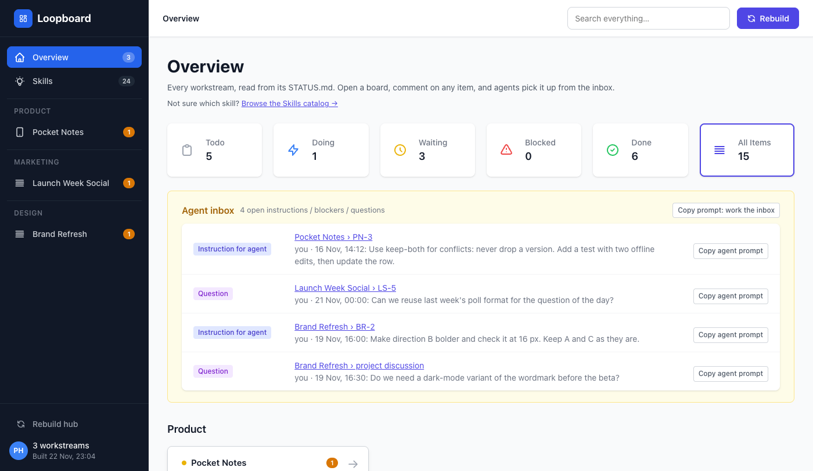
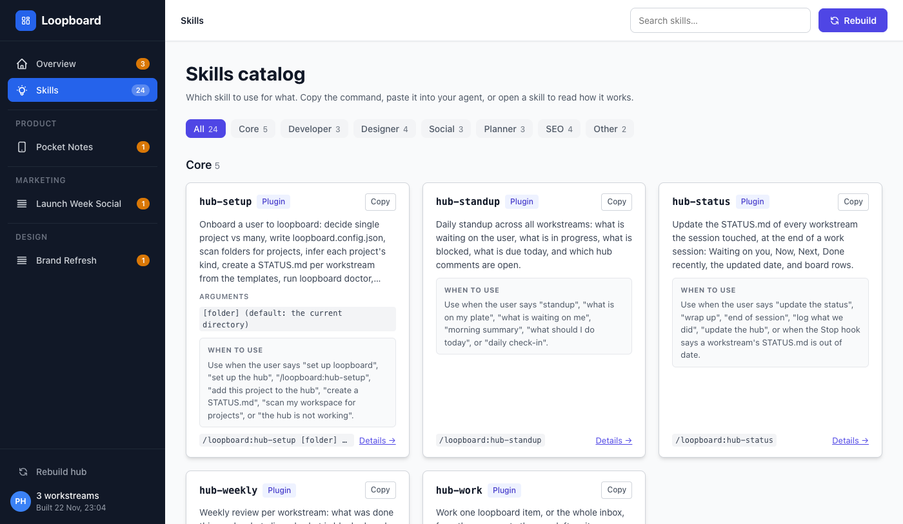
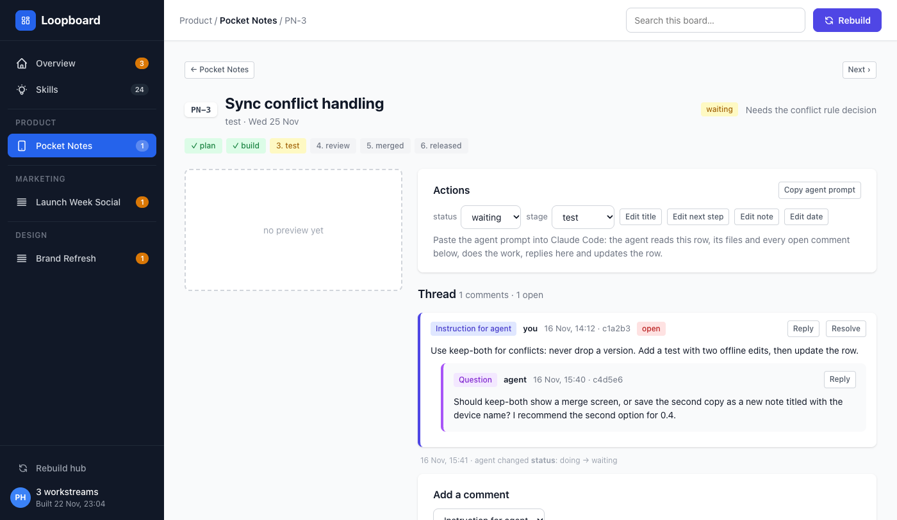

# loopboard

**One `STATUS.md` per project, one local page to see them all, and a comment thread on every item to tell your AI coding agent what to do next.**

For developers, designers, social media posters, planners and SEO writers who work with Claude Code and want their
projects, tasks and agent instructions in plain files instead of another SaaS.



<details><summary>The Skills catalog: which skill to use for what</summary>



</details>

<details><summary>An item page: stages, actions and the comment thread with your agent</summary>



</details>

## Install

**Recommended: Claude Code plugin**

```
/plugin marketplace add bealitamoor/loopboard
/plugin install loopboard@loopboard
```

**Without the plugin: clone and run** (dashboard and CLI, no hooks)

```
git clone https://github.com/bealitamoor/loopboard.git
cd loopboard && node bin/loopboard.mjs init
```

Skills only: `npx skills add bealitamoor/loopboard` (the `skills/` folder is flat, one folder per skill, so this works too).

Needs Node 18 or newer. No other dependencies.

## What you get

| | |
|---|---|
| **Skills** | 21 skills: 5 core plus 16 across 5 roles (developer, designer, social, planner, SEO) |
| **Kinds** | 7 stage sets: `app`, `pipeline`, `campaign`, `research`, `design`, `social`, `plan` |
| **Dashboard** | a local page with a sidebar per workstream, a board with progress dots, a detail page per row |
| **Threads** | comments on any row: instructions, blockers, questions, decisions |
| **Hooks** | a guard that keeps board rows and threads CLI-only and nudges the agent to update `STATUS.md` |
| **Platforms** | macOS, Windows, Linux |

## First prompt to try

After installing, open Claude Code in your project (or workspace) folder and type:

```
/loopboard:hub-setup
```

## Getting started

1. **Install** the plugin (above) or clone the repo.
2. **Run `/loopboard:hub-setup`.** It asks single project or many, scans for projects, proposes a kind for each,
   and creates a `STATUS.md` from the templates.
3. **Open the page** at `http://localhost:4747/hub/` (`loopboard open`). Leave a comment on a row: an instruction for the
   agent.
4. **Tell the agent to work it:** `/loopboard:hub-work inbox`. It reads your comments, does the work, replies in
   the thread and updates the row. Finish a session with `/loopboard:hub-status`.

The command line is `loopboard <command>` (`lb` works as a short alias). It runs from the plugin folder as
`node bin/loopboard.mjs`, or from anywhere after `npm link`.

## Why

- **One file per project.** `STATUS.md` is plain Markdown: current state, what waits on you, a board. It lives in
  your repo or folder, reads fine in any editor and diffs in git. See [docs/FORMAT.md](docs/FORMAT.md).
- **Talk to your agent per item.** Instead of re-explaining context in chat, write "Instruction for agent" on the
  row. The agent reads the thread, replies, and marks things done. You keep a record of what was asked and decided.
- **One place to look.** A single local page across every project, with what is waiting on you at the top.
- **The agent follows rules.** Hooks stop it from hand-editing board rows or writing as you, and remind it to
  update the status file before it stops.

## Single project or many

- **Single project:** one `STATUS.md` at the repo root. `loopboard init --single` writes the config and a starter file.
- **Many projects:** a workspace folder; the hub scans it for every `STATUS.md` and groups them in the sidebar by
  `area`. `loopboard init --multi --areas "Work,Content,Lab"`, then `loopboard new <folder> --title T --kind K` per project.

`mode` in `loopboard.config.json` is `auto` by default: single if the root has a `STATUS.md` and there are no nested
ones, otherwise many.

## The STATUS.md format in 60 seconds

```
---
title: Acme Web App
area: Work
kind: app
health: green
updated: 2026-01-15
summary: Login and billing are done; reports are next.
---
## Waiting on you
- Approve the pricing copy, so billing can ship, by Friday
## Now
## Next
## Board
| ID | Item | Stage | Status | Next step | Date | Note |
|---|---|---|---|---|---|---|
| T01 | Login screen | build | doing | Wire up the form | 2026-01-20 | |
## Items
## Done recently
## Links
```

The kind picks the stages (`app`: plan, build, test, review, merged, released). Board rows change through
`loopboard thread set|addrow|rmrow|order`; the prose sections you edit freely. Full reference:
[docs/FORMAT.md](docs/FORMAT.md).

## Skills

Run them as `/loopboard:<name>` in the plugin, or just say what you want; each skill lists the phrases it answers to.

| Role | Skill | What it does |
|---|---|---|
| Core | `hub-setup` | Onboard: single or many, scan projects, create `STATUS.md` files, run `loopboard doctor`, offer to keep the server running |
| Core | `hub-work` | Work one item, or the whole inbox, from the comments you left; reply, resolve, update the row |
| Core | `hub-status` | End-of-session update: Waiting on you, Now, Next, Done recently, date, rows |
| Core | `hub-standup` | Daily view across projects: waiting on you, due, in progress, blocked |
| Core | `hub-weekly` | Weekly review per workstream, written to `reports/week-YYYY-MM-DD.md` |
| Developer | `dev-ticket` | Ticket from plan to build, test and PR, with the row moving through `app` stages |
| Developer | `dev-release` | Release ledger, changelog entry and tag checklist; tags only on your yes |
| Developer | `dev-bug` | Reproduce, find the cause, fix, verify; records the row and a lesson |
| Designer | `design-brief` | Turn a request into a one-page brief and a `design` row |
| Designer | `design-review` | Review a design against its brief and an accessibility checklist |
| Designer | `design-handoff` | Spec file, asset list and the row moved to `handoff` |
| Social | `social-calendar` | Plan N days of posts as rows with dates and angles |
| Social | `social-post` | Draft one post in your voice: no cliches, `[fill]` instead of invented numbers, links in the first comment |
| Social | `social-recap` | What was posted and a numbers table for you to fill in |
| Planner | `plan-week` | Pick this week's rows within real capacity, in priority order |
| Planner | `plan-today` | Choose the top 3 for today |
| Planner | `plan-review` | Close the day or week: what finished, what slipped and why |
| SEO | `seo-calendar` | An article plan as campaign rows: keyword, intent, cluster, date |
| SEO | `seo-article` | Article from brief to draft to review, sourced and in plain language |
| SEO | `seo-indexing` | Track published pages until indexed; what to request and check |
| SEO | `seo-weekly` | Weekly SEO report with a numbers table and honest gaps |

## Skills catalog

Not sure which skill to use? Open **Skills** in the sidebar (`#skills`). Every skill is a card with a one-line summary,
a "When to use" block with its trigger phrases, the argument hint, a source badge and a **Copy** button that puts the
command on your clipboard (for example `/loopboard:hub-work <stream> <ID>`). Filter by role, search by name or
description, and click a card for the full `SKILL.md`, its `references/` and `scripts/` files and **Open in editor**.
The terminal has the same list: `loopboard skills [--role dev] [--json]`.

Where the skills come from:

| source | folder | invoked as |
|---|---|---|
| Plugin | this plugin's `skills/` | `/loopboard:<name>` |
| Project | `.claude/skills/*/SKILL.md` in each configured root | `/<name>` |
| User | `~/.claude/skills/*/SKILL.md` | `/<name>` |
| Extra | folders listed in `skills.dirs` | `/<name>` |

Skills are grouped by role: a `category` (or `metadata.role`) in the frontmatter wins, else the name prefix
(`hub-` Core, `dev-` Developer, `design-` Designer, `social-` Social, `plan-` Planner, `seo-` SEO); the rest is Other,
shown by source. Config keys in `loopboard.config.json`:

```json
"skills": { "user": true, "dirs": ["../shared-skills"] }
```

- `user`: read `~/.claude/skills` (default `true`; `false` hides your personal skills, for example before a screen share).
- `dirs`: extra folders that contain skill folders (relative to the config file; `~` works).

Skills can come from anywhere, so the page only shows them as escaped text. A skill file is cut at 200 KB, the catalog
stops at 500 skills, unreadable files are skipped, and a link inside a skill folder that points outside it is ignored.

## Your day with loopboard

**Developer.** Morning: `/loopboard:hub-standup` shows what is waiting on you and what is blocked. Leave an
instruction on a row, then `/loopboard:hub-work inbox`. Take a ticket with `/loopboard:dev-ticket`; fix a bug
with `/loopboard:dev-bug`. End the day with `/loopboard:hub-status`. Before a release, `/loopboard:dev-release`.

**Designer.** Start a task with `/loopboard:design-brief`, move it through explore, wireframe and visual,
check it with `/loopboard:design-review`, and hand it over with `/loopboard:design-handoff`. Questions for the
team go in the row's thread.

**Social media.** Plan the fortnight with `/loopboard:social-calendar`, draft each post with
`/loopboard:social-post` (copy-ready fields on the row's detail page), post it yourself, then
`/loopboard:social-recap` once you have the numbers.

**Planner.** Monday: `/loopboard:plan-week`. Each morning: `/loopboard:plan-today` for your top 3. Each evening:
`/loopboard:plan-review`. Friday: `/loopboard:hub-weekly`.

**SEO.** `/loopboard:seo-calendar` plans the articles, `/loopboard:seo-article` writes one at a time,
`/loopboard:seo-indexing` tracks what is published but not indexed, and `/loopboard:seo-weekly` writes the
weekly numbers with `[fill]` for what you still need to paste in.

## Platforms

macOS, Windows and Linux, Node 18 or newer. The server can run in the foreground (`loopboard serve`) or as a background
service (`loopboard service install`; `loopboard service remove` undoes it, `loopboard service status` checks it):

- **macOS:** a launchd LaunchAgent with KeepAlive.
- **Windows:** a file in your Startup folder plus a hidden launcher with a restart loop. No admin rights and no
  visible window. `service remove` stops it and deletes the Startup file; the logs stay.
- **Linux:** `systemd --user` with `Restart=on-failure`.
- **Everywhere:** `loopboard serve` in a terminal works without any service.

Opening the page, revealing a folder and opening your editor use each platform's native command.

## Privacy

- Everything stays on your machine. There is no account, no telemetry and no network call to anyone.
- The server listens on `127.0.0.1` only. Writes need a token, and Host and Origin headers are checked.
- The generated page, the token, logs and caches live in your data directory, never in your repo or workspace:
  `$LOOPBOARD_HOME`, else the plugin data dir, else `~/Library/Application Support/loopboard` (macOS),
  `%APPDATA%\loopboard` (Windows), or `$XDG_DATA_HOME/loopboard` / `~/.local/share/loopboard` (Linux).
- `STATUS.md` and the thread files live in your project, so they go wherever your repo goes. Do not put secrets or
  personal data in them; the skills never do.

## Limits

- Local only: no sync, no sharing, no hosted version. Share through your repo if you want others to see the files.
- Needs Node 18 or newer. No telemetry.
- The guard hooks (plugin only, active only inside your configured roots) block these:
  - hand edits of the thread files and of `## Board` rows (prose sections stay editable; use `loopboard thread`);
  - shell writes to `STATUS.md`;
  - the agent calling the local server port itself, and reading the token file;
  - the agent writing a thread comment `--by you`.

  The Stop hook also blocks once when a workstream's files changed but its `STATUS.md` did not.
  Turn all of it off with `"guard": false` in `loopboard.config.json`.
- Opening `index.html` straight from disk is read-only; use the served page for comments and edits.
- Skills guide the agent; they are instructions, not a sandbox. Review what it does before you publish, push or deploy.

## FAQ

**Do I need Claude Code?** The dashboard and CLI work without it. The skills and hooks are for Claude Code, and the
skills follow the open Agent Skills format, so other agents that read `SKILL.md` files can use them.

**Where does my data live?** `STATUS.md` and thread files in your project folders; the generated page and token in
the data directory above. Nothing is uploaded.

**Can I hide my personal skills from the catalog?** Yes: `"skills": { "user": false }` in `loopboard.config.json`.

**Can I add my own stages or areas?** Yes: `kinds` and `areas` in `loopboard.config.json`. See [docs/FORMAT.md](docs/FORMAT.md).

**Can I edit `STATUS.md` by hand?** Yes, except Board rows when the guard is on: use `loopboard thread set|addrow|rmrow|order`
so history stays intact.

**The page is not loading.** Run `loopboard doctor`; it checks Node, the config, the port and every `STATUS.md`, and prints
fixes. Start the server with `loopboard serve` or `loopboard service install`.

**Will the agent post or publish for me?** No. The skills draft and prepare; posting, pushing, tagging and deploying
need your explicit yes.

**How do I remove it?** `loopboard service remove` if you installed the service, then `/plugin uninstall loopboard`.
Your `STATUS.md` files stay as plain Markdown.

## Contributing

See [CONTRIBUTING.md](CONTRIBUTING.md) (adding a skill or a kind, running `node --test`) and [AGENTS.md](AGENTS.md).
Maintainers: [docs/PUBLISHING.md](docs/PUBLISHING.md).

## License

MIT, see [LICENSE](LICENSE).
